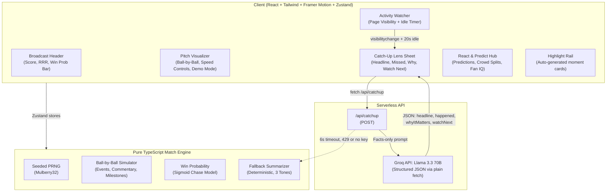

# Catch-Up Lens 🏏✨

> **"Never watch alone."** — AI-powered second-screen artifact that gets split-attention fans back into a live cricket match in 20 seconds.

Built for the **Dream11 Forward Deployed Engineer Intern** hiring assignment.

---

## The Fan Problem

Fans are split-attention. They drift away from a live match — a call, a commute, a snack — and come back lost. The scoreboard shows numbers but not *what happened* or *why it matters*. They're also often watching alone with nobody to react with. Catch-Up Lens solves both problems: it catches a fan up in ≤ 20 seconds and gives them something to do next (predict, react, re-engage).

## The Solution

Catch-Up Lens is a mobile-first, desktop-ready second-screen companion for live T20 cricket. It features:

1. **Live Match Simulator** — Deterministic, seeded, ball-by-ball T20 second-innings chase between two fictional teams (Solar Flares vs Cyber Strikers). Pause/Play, 1x/2x/4x speed, and a 1-click **Demo Mode** that fast-forwards to a tense finish.

2. **"I'm Back" Catch-Up Card** (Hero Feature) — Auto-detects when the fan leaves (Page Visibility API, inactivity timer, or manual button). On return, slides up a glassy bottom-sheet with:
   - Punchy one-line headline
   - "What you missed" (≤ 45 words, strictly enforced)
   - "Why it matters" (win probability swing explained)
   - "Watch next" (upcoming over battle)
   - Key-moments mini timeline
   - Manual timeframe chips: While Away / 2 Min / 5 Overs / Full Chase
   - Tone selector: **Simple** · **Cricket Nerd** · **Hinglish**

3. **React & Predict** — Before every over: predict runs (0-5 / 6-9 / 10+) and wicket (Yes/No). A simulated "Demo Crowd" shows live percentage splits. Predictions resolve with confetti micro-celebrations and a free **Fan IQ** streak score. Six emoji reactions for live banter.

4. **Highlight Rail** — Auto-generated moment cards for sixes, fours, wickets, dropped catches, and milestones.

5. **AI-Powered Summaries** — Server-side Groq API call (`llama-3.3-70b-versatile`) with plain fetch and deterministic template-based fallback. Works perfectly with no API key.

---

## Architecture



---

## AI Layer & Fallback

### How the AI works

The `/api/catchup` endpoint receives structured match data (score, missed events, win probability before/after, current batters, bowler, tone preference) and calls Groq's OpenAI-compatible endpoint (`https://api.groq.com/openai/v1/chat/completions`) using plain `fetch` (no heavy SDK). The model (`llama-3.3-70b-versatile`) is instructed to:
- Use ONLY the provided match facts — never invent players or events
- Return strict JSON: `{headline, happened, whyItMatters, watchNext}`
- Keep "happened" to ≤ 45 words
- Follow the requested tone (Simple, Cricket Nerd, or Hinglish)

The response is sanitized (code fences stripped, word limits enforced, JSON validated).

### Fallback strategy (zero-downtime guarantee)

| Scenario | What happens |
|---|---|
| No `GROQ_API_KEY` set | Instant deterministic summary from template engine |
| API call takes > 6 seconds | Timeout (AbortController) → fallback |
| HTTP error (e.g. 429 rate limit) | Graceful fallback |
| API returns invalid JSON | Fallback |
| Network error | Fallback |
| Any exception | Fallback |

The fallback summarizer uses the same match data to produce tone-aware summaries (Simple, Cricket Nerd, Hinglish) with correct statistics. A badge shows **"Groq AI ⚡"** or **"Instant Engine"** so the user knows the source.

---

## Tech Stack

| Layer | Technology |
|---|---|
| Framework | Vite 6 + React 18 + TypeScript 5 |
| Styling | Tailwind CSS 3 + Framer Motion 11 |
| State | Zustand 5 |
| Icons | Lucide React |
| Celebrations | canvas-confetti |
| AI | Groq API (`llama-3.3-70b-versatile`) via plain `fetch` |
| Testing | Vitest 3 (13+ unit tests) |
| Deployment | Vercel (serverless functions) |

**Bundle size**: ~109 KB gzipped JS, ~6 KB gzipped CSS.

---

## How to Run Locally

```bash
# 1. Clone the repo
git clone <repo-url>
cd catch-up-lens

# 2. Install dependencies
npm install

# 3. Set up environment (optional — app works without API key)
cp .env.example .env
# Edit .env to add your GROQ_API_KEY if you have one

# 4. Run the dev server
npm run dev
# → Opens at http://localhost:3000

# 5. Run tests
npm test
```

---

## 60-Second Demo Script

1. **Open the app** → See the live broadcast header at 0/0, win probability bar, pitch visualizer, and prediction panel. Note the "100% Free to Play • No Real Money • Fictional Teams" banner.

2. **Click "Demo Mode (Tense Finish)"** → Instantly jumps to ~Over 17 with a nail-biting chase scenario (e.g., 19 needed off 14 balls, 5 wickets down). Watch the win probability bar, momentum indicator, and highlight rail populate.

3. **Click "Step Away"** → Simulates being away for 2 minutes. The Catch-Up Lens bottom sheet slides up with a punchy headline, "What you missed" summary, win probability swing visualization, and "Watch next" recommendation.

4. **Switch tones** → Tap "Cricket Nerd" for tactical analysis. Tap "Hinglish" for passionate fan banter ("Double Jhatka!"). Note the "Instant Engine" badge — works without any API key.

5. **Click "Back in the Game"** → Dismiss the card. Make a prediction: tap "6-9 runs" and "NO" for wicket. Watch the demo crowd percentages shift. Tap 🔥 emoji reactions.

6. **Wait for the over to complete** → Prediction resolves with a confetti burst if correct. Fan IQ score updates.

7. **Switch to "Full Scorecard"** tab → See complete batting and bowling stats.

8. **Resize to 360px mobile** → Everything responsive. The floating ✨ FAB opens the catch-up sheet as a bottom sheet.

---

## Project Structure

```
├── api/
│   └── catchup.ts              # Vercel serverless function
├── src/
│   ├── engine/
│   │   ├── types.ts            # All TypeScript interfaces
│   │   ├── prng.ts             # Seeded deterministic PRNG (Mulberry32)
│   │   ├── teams.ts            # Fictional teams & player lineups
│   │   ├── winProbability.ts   # Sigmoid win probability model
│   │   ├── matchSimulator.ts   # Ball-by-ball match engine
│   │   ├── fallbackSummarizer.ts # Deterministic template summarizer
│   │   └── __tests__/
│   │       └── engine.test.ts  # 9 unit tests
│   ├── server/
│   │   ├── catchupHandler.ts   # Groq API integration (Llama 3.3 70B) + fallback
│   │   └── __tests__/
│   │       └── catchup.test.ts # 2 unit tests
│   ├── store/
│   │   ├── useMatchStore.ts    # Match state (Zustand)
│   │   ├── usePredictionStore.ts # Predictions & Fan IQ
│   │   └── useCatchUpStore.ts  # Away detection & catch-up
│   ├── components/
│   │   ├── BroadcastHeader.tsx # Live header & win prob bar
│   │   ├── PitchVisualizer.tsx # Ball-by-ball visualizer & controls
│   │   ├── CatchUpSheet.tsx    # Hero catch-up bottom sheet
│   │   ├── PredictionCard.tsx  # Predict & react panel
│   │   ├── HighlightRail.tsx   # Auto-generated moments rail
│   │   ├── FullScorecard.tsx   # Batting & bowling tables
│   │   ├── FloatingReactions.tsx # Floating emoji animations
│   │   └── ActivityWatcher.tsx # Page Visibility + idle detection
│   ├── App.tsx                 # Main layout
│   ├── main.tsx                # Entry point
│   └── index.css               # Tailwind + custom styles
├── .env.example
├── vercel.json
├── vite.config.ts
├── tailwind.config.js
├── tsconfig.json
├── README.md
└── SUBMISSION.md
```

---

## Accessibility

- Semantic HTML5 elements (`header`, `main`, `footer`, `nav`, `section`, `button`)
- `aria-live="polite"` on catch-up card and commentary for screen reader announcements
- `aria-label` on icon-only buttons
- `role="dialog"` and `aria-modal="true"` on catch-up sheet
- `role="tablist"` and `aria-selected` on view tabs
- Keyboard support: ESC closes modals, all interactive elements are focusable
- `prefers-reduced-motion` respected: animations disabled for users who request it
- 4.5:1+ contrast ratio on all text elements
- Works at 360px minimum width

---

## No Real Money Disclaimer

This is a **100% free-to-play, second-screen prototype**. There is **no real money, betting, wagering, cash, or prize language** anywhere in this product. All teams, players, and logos are **entirely fictional**. The "Fan IQ" score is a free engagement mechanic with no monetary value.

---

## License

Built for Dream11 Forward Deployed Engineer Intern assignment evaluation.
